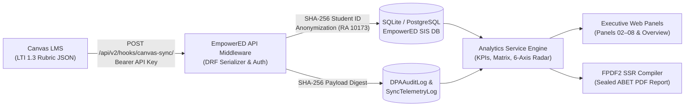
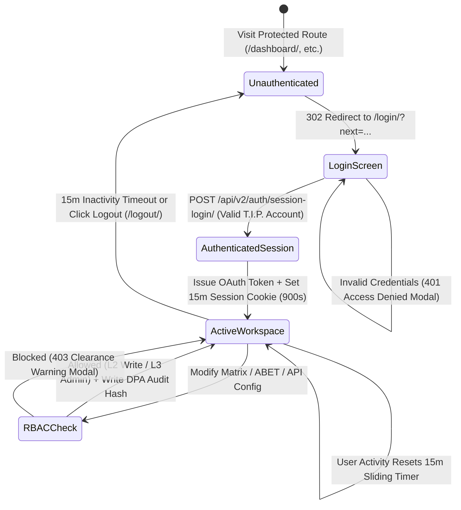

# 🎓 EmpowerED API — Institutional OBE & ABET Analytics Middleware

> **A full-stack Outcomes-Based Education (OBE) & ABET Accreditation Analytics Middleware built with Django 6.0 and Django REST Framework for the Technological Institute of the Philippines (T.I.P.). Designed for direct Canvas LMS LTI 1.3 rubric ingestion, dynamic I/E/R course outcome mapping, 6-axis student competency radar analytics, RA 10173 SHA-256 encrypted DPA audit logging, expiring session security, and automated ABET Self-Study Report (SSR) PDF compilation.**

🌐 **Local Portal:** [http://127.0.0.1:8000/login/](http://127.0.0.1:8000/login/)

📄 **Quick File Links:**
[](empowered_project/settings.py)
[](analytics/models.py)
[](analytics/services.py)
[](analytics/views.py)
[](analytics/serializers.py)
[](analytics/urls.py)
[](analytics/tests.py)
[](.env.example)
[](manage.py)
[](CONTRIBUTING.md)
[](CODE_OF_CONDUCT.md)
[](requirements.txt)

[](https://www.python.org/)
[](https://www.djangoproject.com/)
[](https://www.django-rest-framework.org/)
[](https://www.sqlite.org/)
[](https://py-pdf.github.io/fpdf2/)
[](#️-configuration--security)
[](#-license)

---

## 📋 Table of Contents

### 📌 System Overview & Core Guides
- 🔍 [Overview](#-overview)
- 🎯 [Objectives](#-objectives)
- ✨ [Core Features](#-core-features)
- 🏗️ [System Architecture](#-system-architecture)
- 🛠️ [Tech Stack](#-tech-stack)
- 🚀 [Setup & Installation](#-setup--installation)
- 🔗 [URL & API Endpoints](#-url--api-endpoints)
- 🛡️ [Configuration & Security](#-configuration--security)
- 📁 [Project Structure](#-project-structure)
- 🧑💻 [About](#-about)
- 📄 [License](#-license)

### 📄 Key Source & Configuration Files
- ⚙️ [Django Project & Session Configuration (`empowered_project/settings.py`)](empowered_project/settings.py)
- 🗄️ [Database Schema & RA 10173 Hash Generator (`analytics/models.py`)](analytics/models.py)
- 📊 [OBE KPI Engine, Seed Data & FPDF2 Compiler (`analytics/services.py`)](analytics/services.py)
- 🔌 [REST API v2 Middleware & Protected Views (`analytics/views.py`)](analytics/views.py)
- 🧩 [DRF Request/Response Serializers (`analytics/serializers.py`)](analytics/serializers.py)
- 🔗 [Multi-Page & API v2 URL Dispatcher (`analytics/urls.py`)](analytics/urls.py)
- 🧪 [22-Test Automated Verification Suite (`analytics/tests.py`)](analytics/tests.py)
- 🔐 [Environment Variable Template (`.env.example`)](.env.example)
- 📦 [Python Package Dependencies (`requirements.txt`)](requirements.txt)
- 🤝 [Developer Contribution Guidelines (`CONTRIBUTING.md`)](CONTRIBUTING.md)
- 📜 [Contributor Code of Conduct (`CODE_OF_CONDUCT.md`)](CODE_OF_CONDUCT.md)

---

## 🔍 Overview

Compiling Outcomes-Based Education (OBE) attainment metrics and ABET Self-Study Reports (SSR) across engineering programs using manual spreadsheets is slow, fragmented, and error-prone. **EmpowerED API** is a full-stack Django 6.0 & REST API middleware platform built for the **Technological Institute of the Philippines (T.I.P.)** that automates the entire accreditation analytics pipeline from Canvas LMS to executive decision dashboards.

The system provides four core workflows:

1. **Direct Canvas LMS LTI 1.3 Ingestion & ETL Pipeline** — Receives real-time rubric evaluation payloads from Canvas LMS over a bearer-authenticated REST webhook, measures packet latency and throughput, and maps scores directly into the EmpowerED Student Information System (SIS).
2. **Curriculum OBE Course Mapping Matrix & 6-Axis Competency Radar** — Enables Deans and Quality Assurance (QA) officers to interactively cycle Introductory (`I`), Enabling (`E`), and Reinforcing (`R`) Student Outcome (`SO1`–`SO4`) mappings across Computer Engineering courses (`CPE 311`–`CPE 616`) while tracking 6-axis student competency attainment against an 80% benchmark.
3. **RA 10173 Data Privacy Act SHA-256 Tokenization & Audit Ledger** — Anonymizes all incoming student identification numbers using irreversible SHA-256 cryptographic hashing prior to database persistence and records an immutable SHA-256 audit trail for every `SYNC`, `WRITE`, `EXPORT`, and `AUTH` operation.
4. **Automated ABET SSR PDF Export & Institutional Session Security** — Compiles a downloadable and printable ABET & CHED OBE Self-Study Report (SSR) sealed with a live RA 10173 audit hash, protected by institutional OAuth 2.0 session login, 15-minute expiring session cookies with automatic inactivity logout, and 3-tier Role-Based Access Control (RBAC).

The result: zero manual Excel uploads, real-time accreditation visibility, and verifiable data privacy compliance wrapped in a centered, dark glassmorphic executive interface.

---

## 🎯 Objectives

| Goal | Description |
|---|---|
| 🔄 **Automate LTI 1.3 Sync** | Eliminate manual spreadsheet consolidation via direct Canvas LMS LTI 1.3 webhook ingestion. |
| 📊 **Real-Time Executive KPIs** | Provide Deans & QA teams with live ABET Accreditation, CHED OBE Status, Matrix Coverage, and Curriculum Deficit gauges. |
| 🧩 **Dynamic I/E/R Mapping** | Allow authorized users to interactively map and persist `I` / `E` / `R` Student Outcome proficiencies per course. |
| 🛡️ **Enforce RA 10173 Privacy** | Anonymize student numbers via SHA-256 tokenization and log tamper-evident SHA-256 payload digests in the DPA ledger. |
| 📄 **One-Click ABET SSR Export** | Generate server-compiled PDF reports (`fpdf2`) and sealed printable Self-Study Reports from persistent Criterion 1–7 checklists. |
| 🔐 **Session & RBAC Governance** | Protect all modules with institutional login, 15-minute sliding session cookie expiry, automatic idle logout, and L1–L3 RBAC clearance enforcement. |

---

## ✨ Core Features

### 📊 Administrative Analytics Dashboard (`/dashboard/`)
- **Executive Donut Gauges** — Real-time SVG ring gauges displaying **ABET Accreditation (%)** and **CHED OBE Status (%)**.
- **Live KPI Cards** — Dynamic calculation of **Matrix Coverage (%)** and **Curriculum Deficit (%)** with term-over-term delta indicators.
- **Cohort Ingestion Banner** — Tracks active College of IT student cohort records and live LTI 1.3 batch counts with zero manual Excel uploads required.
- **Centered Workspace Layout** — Vertically and horizontally centered panel card and typography across all viewports.

### 🔄 Live API Middleware Sync Pipeline (`/pipeline/`)
- **Canvas LMS → EmpowerED SIS Flow** — Visualizes the live REST LTI 1.3 rubric stream and database synchronization status.
- **Latency & Throughput Telemetry** — Tracks average API latency (`ms`) over a dynamic SVG area/line sparkline and packet throughput (`k pkt/s`).
- **Live Payload Terminal** — Displays real-time OAuth 2.0 handshake, rubric GET stream, SO1–SO4 ETL mapping, and SHA-256 anonymization status.
- **Manual & Global Sync Trigger** — One-click ETL sync test button in both the pipeline header and global topbar.

### 🧩 Course Outcome Mapping Matrix (`/matrix/`) & Competency Radar (`/competency/`)
- **Interactive I/E/R Matrix** — Click any course-outcome badge (`CPE 311` through `CPE 616` across `SO1`–`SO4`) to cycle `I` → `E` → `R` → `—` (unmapped) with instant database persistence and KPI recalculation.
- **6-Axis SVG Competency Radar** — Plots `Knowledge`, `Problem Solving`, `Design`, `Communication`, `Ethics`, and `Teamwork` against 80% target attainment white markers.
- **5-Domain Attainment Progress Bars** — Tracks aggregated student performance across Knowledge, Technical Skills, Professional Values & Ethics, Capstone Readiness, and Internship Hours Compliance.

### 🛡️ DPA Encrypted Audit Logs (`/audit-logs/`) & ABET PDF Export (`/abet-export/`)
- **RA 10173 Audit Table** — Displays local timestamp (`Asia/Manila`), truncated SHA-256 payload digest (`a3f9c2…7e41b8`), middleware action badge (`SYNC · Canvas`, `WRITE · SO Map`, `EXPORT · PDF`, `AUTH · OAuth`, `AUTH · RBAC`), and DPA verification status.
- **Persistent ABET Criteria 1–7 Checklist** — Database-backed verification checkboxes (`Students`, `Program Educational Objectives`, `Student Outcomes`, `Continuous Improvement`, `Curriculum`, `Faculty`, `Facilities`) that directly update SSR Readiness and ABET Accreditation KPIs.
- **Server-Side PDF Compiler & Sealed Print View** — Downloads a formatted A4 PDF report (`TIP_EmpowerED_ABET_SSR_v2.pdf`) or opens a cryptographically sealed browser print preview (`/abet-report/print/?seal=<hash>`).

### 🔐 Institutional Login (`/login/`), Expiring Session Cookies & Config (`/api-config/`)
- **Institutional Sign-In & Password Toggle** — Validates `@tip.edu.ph` credentials against `InstitutionalUser`, issues a per-login OAuth 2.0 token (`tip_oauth_...`), and includes an interactive eye icon password visibility toggle.
- **15-Minute Expiring Session Cookie & Auto-Logout** — Enforces a 900-second sliding inactivity timeout (`empowered_sessionid`) both server-side and client-side, automatically displaying a **Session Expired** modal and logging out when idle.
- **System Alert Modals** — Smooth glassmorphic modal dialogs (`#system-alert-modal`) with contextual icons and variants (`error`, `warn`, `ok`, `info`) across all templates.
- **RBAC Clearance & API Secret Key Rotation** — Switch between `Level 1 · Read`, `Level 2 · Write`, and `Level 3 · Admin` clearance levels, toggle operational alerts, and rotate the live `tip_live_...` webhook bearer key.

---

## 🏗️ System Architecture

### Overall LTI 1.3 ETL & Analytics Flow



### Session Authentication, Auto-Logout & RBAC Lifecycle



---

## 🛠️ Tech Stack

| Layer / Feature | Technology & Tools | Description |
|---|---|---|
| **Web Framework** | Django 6.0 | Full-stack Python web framework with ORM, session management, and template engine |
| **REST API Layer** | Django REST Framework 3.16+ | RESTful API views, serializers, and JSON/Browsable API renderers |
| **Language** | Python 3.12+ | Core backend analytics engine, SHA-256 tokenization, and PDF compilation |
| **Database** | SQLite 3 (default) / PostgreSQL 17 | Zero-config local SQLite (`db.sqlite3`) or PostgreSQL via `dj-database-url` & `psycopg[binary]` |
| **PDF Generation** | `fpdf2` 2.8+ | Pure-Python A4 ABET Self-Study Report (SSR) PDF generator with DPA audit seals |
| **Frontend UI** | Custom Dark Glassmorphic CSS | Centered responsive workspace, orbital page loader, SVG gauges, and smooth alert modals |
| **Frontend Logic** | Vanilla ES6+ JavaScript | Per-panel modular scripts (`base.js`, `panel1_login.js`–`panel8_config.js`), fetch API & idle timer |
| **Typography** | Inter Sans-Serif & Monospace | Clean executive typography for KPI metrics and monospace SHA-256 audit hashes |
| **Privacy & Security** | Python `hashlib` & `secrets` | SHA-256 student tokenization (RA 10173), timing-safe bearer comparison, and OAuth token generation |
| **Environment Config** | `python-dotenv` 1.2+ | `.env` configuration loader for secrets, debug flags, and database URLs |

---

## 🚀 Setup & Installation

> Detailed step-by-step guide for setting up and running **EmpowerED API** on **Windows** with **Python 3.12+**.

### ✅ Prerequisites

| Tool | Minimum Version | Download |
|---|---|---|
| **Python** | 3.12+ | [python.org/downloads](https://www.python.org/downloads/) |
| **pip** | Latest | Bundled with Python |
| **Git** | Any | [git-scm.com/download/win](https://git-scm.com/download/win) |

---

### 1. Clone the Repository

```powershell
git clone <repository-url>
cd Tip-API
```

Replace `<repository-url>` with the GitHub URL of this repository.

---

### 2. Set Up a Virtual Environment

```powershell
# Create the virtual environment
python -m venv env

# Activate it (PowerShell)
.\env\Scripts\Activate

# Or activate it (Command Prompt)
env\Scripts\activate.bat
```

---

### 3. Install Dependencies

```powershell
pip install -r requirements.txt
```

This installs:
- **Django >= 6.0, < 6.1** (Core web framework & session engine)
- **djangorestframework >= 3.16, < 4.0** (REST API v2 middleware)
- **dj-database-url >= 3.1 & psycopg[binary] >= 3.3** (Database configuration & PostgreSQL driver)
- **python-dotenv >= 1.2** (Environment variable management)
- **fpdf2 >= 2.8** (Server-side ABET SSR PDF report compiler)

---

### 4. Configure Environment Variables (Optional)

By default, the project runs out-of-the-box with SQLite (`db.sqlite3`). To customize settings, copy `.env.example` to `.env`:

```powershell
Copy-Item .env.example .env
```

---

### 5. Run Database Migrations

```powershell
python manage.py migrate
```

> **Note:** Initial T.I.P. Computer Engineering courses (`CPE 311`–`CPE 616`), SO1–SO4 outcome mappings, anonymized competency records, telemetry logs, ABET Criteria 1–7, and institutional accounts are **automatically seeded** on first request or post-migrate.

---

### 6. Start the Development Server

```powershell
python manage.py runserver
```

Open your browser and navigate to `http://127.0.0.1:8000/login/`.

#### 🔑 Default Seeded Institutional Credentials

| Role | Institutional Username | Password | Default Clearance |
|---|---|---|---|
| **College Dean** | `dean.cit@tip.edu.ph` | `TIP@EmpowerED2026` | Level 2 · Write (Switchable L1–L3 in System Config) |
| **Institutional User** | `student.id@tip.edu.ph` | `TIP@EmpowerED2026` | Level 2 · Write |

---

### 7. Run the Automated Test Suite

```powershell
python manage.py test analytics --verbosity 2
```

All **22 automated unit & integration tests** validate auto-seeding, authentication guards, 15-minute session expiration, RBAC enforcement, SHA-256 student anonymization, matrix persistence, ABET checklist synchronization, and PDF generation.

---

## 🔗 URL & API Endpoints

| Category | Endpoint | Method | Route Name | Description |
|---|---|---|---|---|
| **Auth Portal** | `/login/` | `GET` | `panel1-login` | Institutional Login Screen with password visibility toggle & modal alerts |
| **Auth Portal** | `/logout/` | `GET` | `empowered-logout` | Flush active EmpowerED session and redirect to `/login/` |
| **Navigation** | `/` | `GET` | `home` | Root route — renders Administrative Analytics Dashboard (auth required) |
| **Navigation** | `/dashboard/` | `GET` | `panel2-dashboard` | Administrative Analytics Dashboard (ABET/CHED gauges, Matrix Coverage & Deficit) |
| **Navigation** | `/pipeline/` | `GET` | `panel3-pipeline` | Live API Middleware Sync Pipeline (Canvas LTI 1.3 stream, latency & throughput) |
| **Navigation** | `/matrix/` | `GET` | `panel4-matrix` | Curriculum Outcomes-Based Course Mapping Matrix (`I` / `E` / `R` interactive table) |
| **Navigation** | `/competency/` | `GET` | `panel5-competency` | Student Competency 6-Axis Radar Chart & 5-domain attainment progress bars |
| **Navigation** | `/audit-logs/` | `GET` | `panel6-audit` | RA 10173 DPA Encrypted Audit Log Table (SHA-256 payload hashes & actions) |
| **Navigation** | `/abet-export/` | `GET` | `panel7-abet` | ABET Self-Study Report (SSR) Checklist & PDF Export Portal |
| **Navigation** | `/api-config/` | `GET` | `panel8-config` | Middleware System Alerts, API Secret Key Rotation & RBAC Clearance Config |
| **Navigation** | `/overview/` | `GET` | `overview-board` | 8-Panel Master Overview Board (unified multi-panel executive command center) |
| **Printable SSR** | `/abet-report/print/` | `GET` | `abet-report-print` | Printable ABET & CHED OBE Self-Study Report view (`?seal=<sha256_hash>`) |
| **Auth API v2** | `/api/v2/auth/session-login/` | `POST` | `session-login` | Verify institutional email + password, issue OAuth token & start 15m session |
| **Auth API v2** | `/api/v2/auth/sso/` | `POST` | `institutional-sso` | Simulated T.I.P. Microsoft OAuth 2.0 + 2FA verification & audit logging |
| **Webhook API v2** | `/api/v2/hooks/canvas-sync/` | `POST` | `canvas-sync-webhook` | Ingest Canvas LTI 1.3 rubric JSON, SHA-256 anonymize student ID & log telemetry |
| **State API v2** | `/api/v2/dashboard/state/` | `GET` | `dashboard-state` | Aggregate live KPIs, competencies, 6-axis radar, matrix, audits & RBAC state |
| **Matrix API v2** | `/api/v2/matrix/mapping/` | `PATCH` | `course-matrix-mapping` | Persist `I` / `E` / `R` / `-` course outcome mapping (requires RBAC Level >= 2) |
| **ABET API v2** | `/api/v2/abet/criteria/` | `PATCH` | `abet-criteria` | Lock/unlock ABET Criterion 1–7 & recalculate KPIs (requires RBAC Level >= 2) |
| **Report API v2** | `/api/v2/reports/abet-ssr/` | `POST` | `abet-ssr-export` | Compile & stream downloadable `TIP_EmpowerED_ABET_SSR_v2.pdf` binary + DPA audit |
| **Report API v2** | `/api/v2/reports/abet-print-seal/` | `POST` | `abet-print-seal` | Record an `EXPORT · Print` SHA-256 audit seal prior to opening print preview |
| **Config API v2** | `/api/v2/config/rotate-key/` | `POST` | `rotate-api-key` | Rotate live `tip_live_...` API secret key (requires RBAC Level 3 · Admin) |
| **Config API v2** | `/api/v2/config/settings/` | `PATCH` | `middleware-config-settings` | Update active RBAC clearance level (1–3) and performance alert switches |
| **Admin** | `/admin/` | `GET/POST` | `admin:index` | Django built-in Admin portal for inspecting models and audit records |

---

## 🛡️ Configuration & Security

| Setting / Feature | Default | Configuration / Recommendation |
|---|---|---|
| `DEBUG` | `True` | Controlled via `DJANGO_DEBUG` in `.env`. Set to `False` in production. |
| `SECRET_KEY` | Environment / Fallback | Loaded via `os.getenv('DJANGO_SECRET_KEY', ...)`. Override in production `.env`. |
| `ALLOWED_HOSTS` | `127.0.0.1,localhost,testserver,*` | Controlled via `DJANGO_ALLOWED_HOSTS`. Restrict to institutional domain in production. |
| `DATABASES` | SQLite3 (`db.sqlite3`) | Automatically switches to PostgreSQL when `DATABASE_URL` is set in `.env`. |
| `SESSION_COOKIE_NAME` | `empowered_sessionid` | Dedicated institutional session cookie identifier. |
| `SESSION_COOKIE_AGE` | `900` (15 Minutes) | Sliding 15-minute inactivity timeout (`DJANGO_SESSION_COOKIE_AGE`) with server & client auto-logout. |
| `SESSION_SAVE_EVERY_REQUEST` | `True` | Refreshes the 15-minute session expiration window on every active request. |
| `SESSION_EXPIRE_AT_BROWSER_CLOSE` | `True` | Automatically invalidates the session cookie when the user closes the browser. |
| `SESSION_COOKIE_HTTPONLY` | `True` | Blocks client-side scripts from reading the raw session cookie. |
| `RA 10173 Anonymization` | `SHA-256` | Student IDs in Canvas webhooks are hashed via `hashlib.sha256` before persistence. |
| `RBAC Enforcement` | Levels `1` / `2` / `3` | Level 1 (Read-Only), Level 2 (Matrix, ABET & Alert Write), Level 3 (Admin API Key Rotation). |
| `Webhook Bearer Auth` | `secrets.compare_digest` | Constant-time comparison of `Authorization: Bearer <key>` or `X-API-Key` against `MiddlewareConfig`. |

---

## 📁 Project Structure

```text
📦 Tip-API/
├── 📂 empowered_project/          ⚙️ Django project configuration package
│   ├── 🐍 __init__.py             # Package initializer
│   ├── 🐍 settings.py             # Project settings, DB config & 15m expiring session cookies
│   ├── 🐍 urls.py                 # Root URL router (/admin/ + analytics.urls)
│   ├── 🐍 wsgi.py                 # WSGI production entry point
│   └── 🐍 asgi.py                 # ASGI asynchronous entry point
├── 📂 analytics/                  📊 Main EmpowerED Analytics & Middleware app
│   ├── 📂 migrations/             🗄️ Database schema migrations
│   │   ├── 🐍 0001_initial.py     # Initial models (InstitutionalUser, Course, DPAAuditLog, etc.)
│   │   └── 🐍 0002_abetcriterion.py # Persistent ABETCriterion checklist model
│   ├── 📂 templates/              🎨 Server-rendered HTML templates (centered workspace layout)
│   │   ├── 🌐 base.html           # Master app shell (topbar, sidebar nav, loader, alert modal)
│   │   ├── 🌐 overview_board.html # 8-Panel Master Overview Board
│   │   ├── 🌐 panel1_login.html   # Institutional Login Screen
│   │   ├── 🌐 panel2_dashboard.html # Administrative Analytics Dashboard
│   │   ├── 🌐 panel3_pipeline.html  # Live API Middleware Sync Pipeline
│   │   ├── 🌐 panel4_matrix.html    # Curriculum OBE Course Mapping Matrix
│   │   ├── 🌐 panel5_competency.html# Student Competency Radar Chart & Progress
│   │   ├── 🌐 panel6_audit.html     # DPA Encrypted Audit Log Table
│   │   ├── 🌐 panel7_abet.html      # ABET Self-Study Report PDF Export Portal
│   │   ├── 🌐 panel8_config.html    # Middleware System Alerts & API Config
│   │   └── 🌐 abet_report_print.html# Printable ABET & CHED OBE Self-Study Report
│   ├── 📂 static/                 🎨 Modular frontend static assets
│   │   ├── 📂 css/                🎨 Dedicated per-template stylesheets
│   │   │   ├── 🎨 base.css        # Core theme variables, centered layout, sidebar & modal styles
│   │   │   ├── 🎨 overview_board.css
│   │   │   ├── 🎨 panel1_login.css
│   │   │   ├── 🎨 panel2_dashboard.css
│   │   │   ├── 🎨 panel3_pipeline.css
│   │   │   ├── 🎨 panel4_matrix.css
│   │   │   ├── 🎨 panel5_competency.css
│   │   │   ├── 🎨 panel6_audit.css
│   │   │   ├── 🎨 panel7_abet.css
│   │   │   ├── 🎨 panel8_config.css
│   │   │   └── 🎨 abet_report_print.css
│   │   └── 📂 javascript/         📜 Dedicated per-template frontend scripts
│   │       ├── 📜 base.js         # Alert modal engine, page loader, global sync & 15m idle auto-logout
│   │       ├── 📜 overview_board.js
│   │       ├── 📜 panel1_login.js
│   │       ├── 📜 panel2_dashboard.js
│   │       ├── 📜 panel3_pipeline.js
│   │       ├── 📜 panel4_matrix.js
│   │       ├── 📜 panel5_competency.js
│   │       ├── 📜 panel6_audit.js
│   │       ├── 📜 panel7_abet.js
│   │       └── 📜 panel8_config.js
│   ├── 🐍 admin.py                # Django Admin model registrations
│   ├── 🐍 apps.py                 # AppConfig & post-migrate auto-seeding hook
│   ├── 🐍 models.py               # 8 ORM models (User, Course, Mapping, Competency, Audit, ABET, Config)
│   ├── 🐍 serializers.py          # 8 DRF serializers for API payload validation
│   ├── 🐍 services.py             # Seed engine, KPI & radar calculator, and FPDF2 SSR compiler
│   ├── 🐍 urls.py                 # Multi-page & REST API v2 route definitions
│   ├── 🐍 views.py                # Auth guard, template views & 10 REST API v2 views
│   └── 🐍 tests.py                # 22 automated unit & API integration tests
├── 🗄️ db.sqlite3                  # Local SQLite database (auto-seeded)
├── 🔐 .env.example                # Environment configuration template
├── 🙈 .gitignore                  # Git ignore rules
├── 🐍 manage.py                   # Django management CLI
├── 📦 requirements.txt            # Python package dependencies
├── 🤝 CONTRIBUTING.md             # Developer contribution guidelines & PR workflow
├── 📜 CODE_OF_CONDUCT.md          # Contributor Code of Conduct (Contributor Covenant v2.1)
└── 📄 README.md                   # System documentation
```

---

## 🧑💻 About

### The Project

**EmpowerED API** was developed for the **Technological Institute of the Philippines (T.I.P.)** as an institutional Outcomes-Based Education (OBE) and ABET Accreditation Analytics Middleware. It bridges **Canvas LMS** and the **EmpowerED Student Information System (SIS)** via LTI 1.3 REST webhooks — replacing manual spreadsheet consolidation with real-time executive KPIs, interactive curriculum mapping, automated ABET Self-Study Report (SSR) compilation, and strict compliance with **Republic Act No. 10173 (Data Privacy Act of 2012)**.

---

## 📄 License

This project is licensed under the **MIT License** — see the license notice below for full details.

```text
MIT License

Copyright (c) 2026 John Tyrone Pagunsan Coronel (TheUnshackled1) — https://github.com/TheUnshackled1

Permission is hereby granted, free of charge, to any person obtaining a copy
of this software and associated documentation files (the "Software"), to deal
in the Software without restriction, including without limitation the rights
to use, copy, modify, merge, publish, distribute, sublicense, and/or sell
copies of the Software, and to permit persons to whom the Software is
furnished to do so, subject to the following conditions:

The above copyright notice and this permission notice shall be included in all
copies or substantial portions of the Software.

THE SOFTWARE IS PROVIDED "AS IS", WITHOUT WARRANTY OF ANY KIND, EXPRESS OR
IMPLIED, INCLUDING BUT NOT LIMITED TO THE WARRANTIES OF MERCHANTABILITY,
FITNESS FOR A PARTICULAR PURPOSE AND NONINFRINGEMENT.
```
