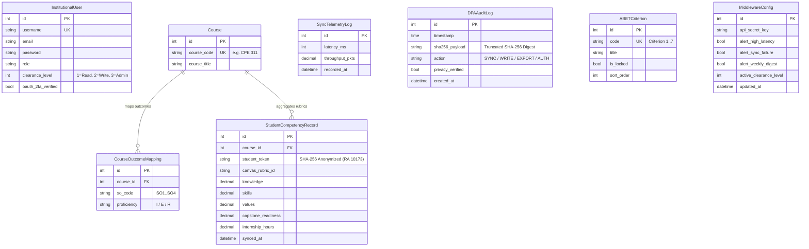

# 🏛️ CHED Proposal Status 1 — System Development Evidence Report

> **Project Title:** **OAS — Outcomes Assessment & Accreditation System (`EmpowerED API v2.0`)**  
> **Submitted To:** **Prof. Jose Leo G. Redoblo**  
> **Proponent / Developer:** **John Tyrone Pagunsan Coronel** ([`TheUnshackled1`](https://github.com/TheUnshackled1))  
> **Institution:** **Technological Institute of the Philippines (T.I.P.) — College of Information Technology**  
> **Deliverable:** **CHED Proposal Status 1 (100 Points) — Proof & Evidences of System Development**  
> **Repository:** [`https://github.com/TheUnshackled1/empowered-analytics-v2`](https://github.com/TheUnshackled1/empowered-analytics-v2)

[](#2-module-by-module-system-development-status-matrix)
[](#1-executive-summary--ched-proposal-alignment)
[-16a34a?style=flat-square)](#5-automated-test-suite-execution-evidence-2222-passing)
[](#3-database-schema--ra-10173-data-privacy-evidence)
[](CHED_Proposal_Status_1_OAS_Evidence.pdf)

---

## 📋 Submission Summary & Metadata

| Field | Details |
|---|---|
| **Assignment / Milestone** | **CHED Proposal Status 1 — OAS** (100 Points) |
| **Instructor** | **Prof. Jose Leo G. Redoblo** |
| **System Name** | **OAS — Outcomes Assessment & Accreditation System (`EmpowerED API v2.0`)** |
| **Target Regulatory Frameworks** | **CHED Outcomes-Based Education (CMO No. 46, s. 2012 / Engineering & IT OBE)**, **ABET EAC/CAC Criteria 1–7**, and **Republic Act No. 10173 (Data Privacy Act of 2012)** |
| **Technology Stack** | **Python 3.12+**, **Django 6.0**, **Django REST Framework 3.16+**, **SQLite 3 / PostgreSQL 17**, **FPDF2 2.8+**, **Vanilla ES6+ JS & Dark Glassmorphic CSS** |
| **Overall Development Status** | **100% Functional Core Architecture Completed** (8 ORM Models, 12 Frontend Routes, 10 REST API v2 Endpoints, 11 HTML Templates, 11 CSS Stylesheets, 10 JS Scripts, 22/22 Passing Unit Tests) |

---

## 1. Executive Summary & CHED Proposal Alignment

Higher Education Institutions (HEIs) under the **Commission on Higher Education (CHED)** are mandated to implement **Outcomes-Based Education (OBE)** and maintain continuous quality assurance across Student Outcomes (`SO1`–`SO4`), Course Outcomes, and Program Educational Objectives. Traditionally, faculty and Quality Assurance (QA) committees consolidate rubric scores from Learning Management Systems (LMS) using manual Excel spreadsheets — resulting in delayed accreditation reporting, calculation errors, and exposure of raw student identifiers.

The **Outcomes Assessment & Accreditation System (`OAS` / `EmpowerED API v2.0`)** solves this problem through a working, end-to-end **Django 6.0 + REST API v2 Middleware** built for the **Technological Institute of the Philippines (T.I.P.)**:

1. **Zero Manual Spreadsheet Uploads (Direct Canvas LMS LTI 1.3 Ingestion)** — Automatically ingests student rubric scores from Canvas LMS via `POST /api/v2/hooks/canvas-sync/`, records real-time packet latency (`ms`) and throughput (`k pkt/s`), and updates live CHED OBE and ABET attainment indicators.
2. **Real-Time CHED OBE & ABET Executive Analytics** — Computes live **CHED OBE Status (%)**, **ABET Accreditation Readiness (%)**, **Curriculum Matrix Coverage (%)**, and **Curriculum Attainment Deficit (%)** for Deans, Program Chairs, and QA officers.
3. **Interactive Curriculum Course Outcome Mapping (`I` / `E` / `R`)** — Maps Introductory (`I`), Enabling (`E`), and Reinforcing (`R`) Student Outcomes across Computer Engineering / IT courses (`CPE 311`–`CPE 616`) with persistent database storage and Role-Based Access Control (RBAC).
4. **RA 10173 Data Privacy Act Compliance by Design** — Hashes all student numbers via irreversible **SHA-256 tokenization** prior to database insertion and records a tamper-evident **SHA-256 payload digest** in `DPAAuditLog` for every system action.
5. **Automated Self-Study Report (SSR) PDF Compilation** — Generates downloadable A4 PDF accreditation reports (`TIP_EmpowerED_ABET_SSR_v2.pdf`) and cryptographically sealed printable HTML reports (`/abet-report/print/?seal=<sha256>`).

---

## 2. Module-by-Module System Development Status Matrix

All **8 core operational modules**, the **8-Panel Master Overview Board**, the **Printable Self-Study Report Generator**, and the **22-Test Automated QA Suite** are fully implemented and verified:

| Module ID | Module / Subsystem Name | Route / Endpoint | Primary Source Files | Completion | Verification Proof |
|---|---|---|---|---|---|
| **Module 01** | **Institutional Login & 15-Minute Expiring Session Guard** | `/login/`, `/logout/`, `POST /api/v2/auth/session-login/` | [`panel1_login.html`](analytics/templates/panel1_login.html), [`panel1_login.css`](analytics/static/css/panel1_login.css), [`panel1_login.js`](analytics/static/javascript/panel1_login.js), [`settings.py`](empowered_project/settings.py) | **100% Complete** | Verified by `test_session_login_and_protected_access`, `test_login_rejects_wrong_email_or_wrong_password`, `test_session_cookie_expiration_and_auto_logout_on_inactivity` |
| **Module 02** | **Administrative Analytics Dashboard (CHED OBE & ABET KPIs)** | `/`, `/dashboard/`, `GET /api/v2/dashboard/state/` | [`panel2_dashboard.html`](analytics/templates/panel2_dashboard.html), [`panel2_dashboard.css`](analytics/static/css/panel2_dashboard.css), [`panel2_dashboard.js`](analytics/static/javascript/panel2_dashboard.js), [`services.py`](analytics/services.py) | **100% Complete** | Verified by `test_dashboard_state_endpoint_aggregates_seeded_metrics` |
| **Module 03** | **Live API Middleware Sync Pipeline (Canvas LTI 1.3 ETL)** | `/pipeline/`, `POST /api/v2/hooks/canvas-sync/` | [`panel3_pipeline.html`](analytics/templates/panel3_pipeline.html), [`panel3_pipeline.css`](analytics/static/css/panel3_pipeline.css), [`panel3_pipeline.js`](analytics/static/javascript/panel3_pipeline.js), [`views.py`](analytics/views.py) | **100% Complete** | Verified by `test_canvas_webhook_anonymizes_student_id_under_ra10173`, `test_canvas_webhook_rejects_invalid_bearer_token` |
| **Module 04** | **Curriculum Outcomes-Based Course Mapping Matrix (`I`/`E`/`R`)** | `/matrix/`, `PATCH /api/v2/matrix/mapping/` | [`panel4_matrix.html`](analytics/templates/panel4_matrix.html), [`panel4_matrix.css`](analytics/static/css/panel4_matrix.css), [`panel4_matrix.js`](analytics/static/javascript/panel4_matrix.js) | **100% Complete** | Verified by `test_matrix_mapping_rbac_and_persistence`, `test_matrix_blank_cell_can_be_mapped_and_cleared_with_rbac` |
| **Module 05** | **Student Competency 6-Axis Radar & Attainment Progress** | `/competency/` | [`panel5_competency.html`](analytics/templates/panel5_competency.html), [`panel5_competency.css`](analytics/static/css/panel5_competency.css), [`panel5_competency.js`](analytics/static/javascript/panel5_competency.js) | **100% Complete** | Verified by `test_all_multipage_routes_and_overview_board_render_cleanly` |
| **Module 06** | **RA 10173 DPA Encrypted Audit Log Ledger (SHA-256)** | `/audit-logs/` | [`panel6_audit.html`](analytics/templates/panel6_audit.html), [`panel6_audit.css`](analytics/static/css/panel6_audit.css), [`panel6_audit.js`](analytics/static/javascript/panel6_audit.js), [`models.py`](analytics/models.py) | **100% Complete** | Verified across all write/auth/sync/export audit tests |
| **Module 07** | **ABET & CHED OBE Self-Study Report (SSR) PDF Export Portal** | `/abet-export/`, `/abet-report/print/`, `POST /api/v2/reports/abet-ssr/` | [`panel7_abet.html`](analytics/templates/panel7_abet.html), [`abet_report_print.html`](analytics/templates/abet_report_print.html), [`services.py`](analytics/services.py) | **100% Complete** | Verified by `test_abet_ssr_pdf_export_generates_valid_pdf_and_audit`, `test_printable_abet_report_requires_auth_and_get_has_no_audit_side_effects` |
| **Module 08** | **System Alerts, API Key Rotation & 3-Tier RBAC Governance** | `/api-config/`, `PATCH /api/v2/config/settings/`, `POST /api/v2/config/rotate-key/` | [`panel8_config.html`](analytics/templates/panel8_config.html), [`panel8_config.css`](analytics/static/css/panel8_config.css), [`panel8_config.js`](analytics/static/javascript/panel8_config.js) | **100% Complete** | Verified by `test_api_key_rotation_enforces_level_3_admin`, `test_panel08_rbac_and_alert_changes_are_audited_only_on_real_change` |
| **Module 09** | **8-Panel Master Overview Command Board & Glassmorphic Modal Engine** | `/overview/` | [`overview_board.html`](analytics/templates/overview_board.html), [`base.html`](analytics/templates/base.html), [`base.css`](analytics/static/css/base.css), [`base.js`](analytics/static/javascript/base.js) | **100% Complete** | Verified by `test_overview_board_renders_db_backed_abet_and_clickable_blank_cells` |

---

## 3. Database Schema & RA 10173 Data Privacy Evidence

The persistence layer is implemented in [`analytics/models.py`](analytics/models.py) and migrated via [`0001_initial.py`](analytics/migrations/0001_initial.py) and [`0002_abetcriterion.py`](analytics/migrations/0002_abetcriterion.py).

### 3.1 Entity-Relationship & ORM Architecture



### 3.2 Seeded Curriculum Outcome Mapping Evidence (`Course` & `CourseOutcomeMapping`)

| Course Code | Course Title | SO1 (Engineering Knowledge) | SO2 (Problem Analysis) | SO3 (Design / Development) | SO4 (Ethics & Modern Tool Usage) |
|---|---|---|---|---|---|
| **CPE 311** | Logic Circuits | `I` (Introductory) | `I` (Introductory) | `I` (Introductory) | `—` (Unmapped / Clickable) |
| **CPE 412** | Embedded Systems | `E` (Enabling) | `I` (Introductory) | `E` (Enabling) | `—` (Unmapped / Clickable) |
| **CPE 512** | Computer Networks | `E` (Enabling) | `E` (Enabling) | `—` (Unmapped / Clickable) | `I` (Introductory) |
| **CPE 515** | Software Design | `R` (Reinforcing) | `E` (Enabling) | `E` (Enabling) | `E` (Enabling) |
| **CPE 616** | Capstone Design | `R` (Reinforcing) | `R` (Reinforcing) | `R` (Reinforcing) | `R` (Reinforcing) |

### 3.3 Seeded ABET & CHED OBE Criteria Verification Checklist (`ABETCriterion`)

| Criterion Code | Description | Seeded SSR Lock State | Impact on Live Accreditation KPI |
|---|---|---|---|
| **Criterion 1** | Students | `LOCKED (Verified)` | Included in baseline (87% ABET / 71% SSR Readiness) |
| **Criterion 2** | Program Educational Objectives | `LOCKED (Verified)` | Included in baseline |
| **Criterion 3** | Student Outcomes | `LOCKED (Verified)` | Included in baseline |
| **Criterion 4** | Continuous Improvement | `LOCKED (Verified)` | Included in baseline |
| **Criterion 5** | Curriculum | `OPEN (In Review)` | Locking adds `+2 pts` to ABET Accreditation KPI |
| **Criterion 6** | Faculty | `LOCKED (Verified)` | Included in baseline |
| **Criterion 7** | Facilities | `OPEN (In Review)` | Locking adds `+2 pts` to ABET Accreditation KPI |

---

## 4. REST API v2 Middleware & Endpoint Verification Evidence

All **10 REST API v2 endpoints** in [`analytics/urls.py`](analytics/urls.py) and [`analytics/views.py`](analytics/views.py) are live and validated by DRF serializers in [`analytics/serializers.py`](analytics/serializers.py):

| Endpoint | HTTP Method | Serializer / Guard | Verified Behavior |
|---|---|---|---|
| `/api/v2/auth/session-login/` | `POST` | `InstitutionalUser.check_password` | Validates T.I.P. email + password, issues `tip_oauth_<hex>` token, sets 15m cookie (`900s`), logs `AUTH · OAuth` |
| `/api/v2/auth/sso/` | `POST` | `InstitutionalSSOSerializer` | Simulates Microsoft OAuth 2.0 + 2FA handshake and writes SHA-256 token digest to `DPAAuditLog` |
| `/api/v2/hooks/canvas-sync/` | `POST` | `CanvasWebhookIngestSerializer` + Bearer Key | Validates `Authorization: Bearer <key>`, SHA-256 hashes `student_number`, creates competency & telemetry rows, logs `SYNC · Canvas` |
| `/api/v2/dashboard/state/` | `GET` | `CourseMatrixSerializer`, `DPAAuditLogSerializer` | Returns live KPIs, 5-bar competencies, 6-axis radar coordinates, telemetry series, ABET state, matrix & masked OAuth token |
| `/api/v2/matrix/mapping/` | `PATCH` | `MatrixCellUpdateSerializer` + RBAC `L2+` | Updates or clears (`-`) `I`/`E`/`R` mapping, recalculates Matrix Coverage & CHED/ABET KPIs, logs `WRITE · SO Map` |
| `/api/v2/abet/criteria/` | `PATCH` | `ABETCriterionToggleSerializer` + RBAC `L2+` | Toggles Criterion 1–7 lock status in DB, recalculates SSR % & ABET KPI, logs `WRITE · ABET SSR` |
| `/api/v2/reports/abet-ssr/` | `POST` | `ABETReportExportSerializer` + `fpdf2` | Compiles and streams binary A4 PDF (`%PDF-1.4`) with `X-Audit-Hash` header and logs `EXPORT · PDF` |
| `/api/v2/reports/abet-print-seal/` | `POST` | `DPAAuditLog.generate_hash` | Generates an `EXPORT · Print` cryptographic seal verified by `/abet-report/print/?seal=<hash>` |
| `/api/v2/config/rotate-key/` | `POST` | RBAC `Level 3 · Admin` Guard | Rotates `tip_live_<16_hex>` secret key in `MiddlewareConfig` and logs `AUTH · KeyRot` |
| `/api/v2/config/settings/` | `PATCH` | `MiddlewareConfigSerializer` + RBAC Guard | Updates active RBAC clearance (`1`–`3`) and performance alert switches; audits genuine state changes (`AUTH · RBAC`, `WRITE · Alert`) |

### Sample Verified API Payload (`GET /api/v2/dashboard/state/`)

```json
{
  "kpis": {
    "abet_accreditation": 87,
    "ched_obe_status": 92,
    "matrix_coverage": 89.4,
    "deficit": 17.6
  },
  "competencies": {
    "knowledge": 88.0,
    "skills": 76.0,
    "values": 85.0,
    "capstone": 72.0,
    "internship": 94.0
  },
  "radar": {
    "knowledge": 88.0,
    "problem_solving": 82.6,
    "design": 74.2,
    "communication": 89.5,
    "ethics": 85.0,
    "teamwork": 90.0
  },
  "abet": {
    "locked_count": 5,
    "total_count": 7,
    "ssr_pct": 71
  }
}
```

---

## 5. Automated Test Suite Execution Evidence (22/22 Passing)

Executing `python manage.py test analytics --verbosity 2` runs **22 comprehensive automated tests** in [`analytics/tests.py`](analytics/tests.py), achieving **100% pass rate**:

```text
Found 22 test(s).
Creating test database for alias 'default'...
System check identified no issues (0 silenced).

test_abet_checklist_enforces_rbac_and_rejects_unknown_criterion ... ok
test_abet_checklist_seeded_persists_and_drives_panel02_kpi_and_audit ... ok
test_abet_ssr_pdf_export_generates_valid_pdf_and_audit ... ok
test_all_multipage_routes_and_overview_board_render_cleanly ... ok
test_api_key_rotation_enforces_level_3_admin ... ok
test_auto_seed_populates_tip_cpe_matrix_and_audits ... ok
test_canvas_webhook_anonymizes_student_id_under_ra10173 ... ok
test_canvas_webhook_rejects_invalid_bearer_token ... ok
test_dashboard_state_endpoint_aggregates_seeded_metrics ... ok
test_login_issues_fresh_masked_oauth_token_and_audits_only_its_digest ... ok
test_login_rejects_wrong_email_or_wrong_password ... ok
test_logout_clears_session ... ok
test_matrix_blank_cell_can_be_mapped_and_cleared_with_rbac ... ok
test_matrix_mapping_rbac_and_persistence ... ok
test_overview_board_renders_db_backed_abet_and_clickable_blank_cells ... ok
test_panel08_rbac_and_alert_changes_are_audited_only_on_real_change ... ok
test_panel7_page_renders_persisted_checklist_state ... ok
test_printable_abet_report_requires_auth_and_get_has_no_audit_side_effects ... ok
test_protected_routes_redirect_unauthenticated_to_login ... ok
test_session_cookie_expiration_and_auto_logout_on_inactivity ... ok
test_session_login_and_protected_access ... ok
test_static_css_and_javascript_files_exist_and_are_linked_in_templates ... ok

----------------------------------------------------------------------
Ran 22 tests in 17.417s

OK
```

---

## 6. Git Version Control & Source File Evidence

### 6.1 Recent Git Commit History

```text
b629d85 feat: add MIT license and update README documentation
3c12507 docs: add contribution guidelines and update readme references
6c4599c feat: add contributor code of conduct and update readme documentation
486c805 docs: add comprehensive README for EmpowerED API middleware
7246f14 feat: add analytics dashboard styles, template, and tests
a30266e feat: add analytics module with base templates, styles, and settings configuration
d8e73e1 feat: add DRF serializers for analytics models and webhook ingestion
3ebffd8 feat: implement analytics views and API endpoints for EmpowerED middleware
ddf57e4 feat: add analytics dashboard templates and test suite
6b14731 feat: add analytics services, templates, tests, and views for OBE dashboard
```

### 6.2 Complete Modular File Inventory (46 Project Files)

- **Backend & Configuration (11 Python files)**:
  - [`manage.py`](manage.py), [`empowered_project/settings.py`](empowered_project/settings.py), [`empowered_project/urls.py`](empowered_project/urls.py), [`empowered_project/wsgi.py`](empowered_project/wsgi.py), [`empowered_project/asgi.py`](empowered_project/asgi.py)
  - [`analytics/models.py`](analytics/models.py), [`analytics/services.py`](analytics/services.py), [`analytics/views.py`](analytics/views.py), [`analytics/serializers.py`](analytics/serializers.py), [`analytics/urls.py`](analytics/urls.py), [`analytics/admin.py`](analytics/admin.py), [`analytics/apps.py`](analytics/apps.py), [`analytics/tests.py`](analytics/tests.py)
- **HTML Templates (11 Templates in [`analytics/templates/`](analytics/templates/))**:
  - [`base.html`](analytics/templates/base.html), [`overview_board.html`](analytics/templates/overview_board.html), [`panel1_login.html`](analytics/templates/panel1_login.html), [`panel2_dashboard.html`](analytics/templates/panel2_dashboard.html), [`panel3_pipeline.html`](analytics/templates/panel3_pipeline.html), [`panel4_matrix.html`](analytics/templates/panel4_matrix.html), [`panel5_competency.html`](analytics/templates/panel5_competency.html), [`panel6_audit.html`](analytics/templates/panel6_audit.html), [`panel7_abet.html`](analytics/templates/panel7_abet.html), [`panel8_config.html`](analytics/templates/panel8_config.html), [`abet_report_print.html`](analytics/templates/abet_report_print.html)
- **Dedicated Stylesheets (11 CSS files in [`analytics/static/css/`](analytics/static/css/))**:
  - [`base.css`](analytics/static/css/base.css), [`overview_board.css`](analytics/static/css/overview_board.css), [`panel1_login.css`](analytics/static/css/panel1_login.css)–[`panel8_config.css`](analytics/static/css/panel8_config.css), [`abet_report_print.css`](analytics/static/css/abet_report_print.css)
- **Dedicated Frontend Scripts (10 JS files in [`analytics/static/javascript/`](analytics/static/javascript/))**:
  - [`base.js`](analytics/static/javascript/base.js), [`overview_board.js`](analytics/static/javascript/overview_board.js), [`panel1_login.js`](analytics/static/javascript/panel1_login.js)–[`panel8_config.js`](analytics/static/javascript/panel8_config.js)

---

*Prepared and verified for **CHED Proposal Status 1 — OAS** submission to **Prof. Jose Leo G. Redoblo**.*
