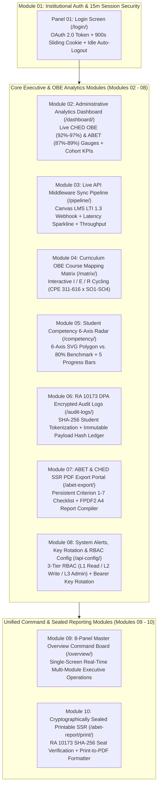

# 🏛️ CHED Proposal Status 2 — Full System Modules Evidence Report

> **Project Title:** **OAS — Outcomes Assessment & Accreditation System (`EmpowerED API v2.0`)**  
> **Submitted To:** **Prof. Jose Leo G. Redoblo**  
> **Proponent / Lead Developer:** **John Tyrone Pagunsan Coronel** ([`TheUnshackled1`](https://github.com/TheUnshackled1))  
> **Institution:** **Technological Institute of the Philippines (T.I.P.) — College of Information Technology**  
> **Deliverable:** **CHED Proposal Status 2 (100 Points) — Evidence of FULL SYSTEM MODULES**  
> **Repository:** [`https://github.com/TheUnshackled1/empowered-analytics-v2`](https://github.com/TheUnshackled1/empowered-analytics-v2)

[-10b981?style=flat-square)](#1-master-inventory-of-all-10-full-system-modules)

[-16a34a?style=flat-square)](#12-module-to-automated-test-verification-matrix-2222-passing)

---

## 📋 Submission Metadata & Scope

| Field | Details |
|---|---|
| **Assignment / Milestone** | **CHED Proposal Status 2 — OAS** (100 Points · Due 8:30 AM) |
| **Requirement** | *Show evidence of FULL SYSTEM MODULES for your proposal* |
| **Instructor** | **Prof. Jose Leo G. Redoblo** |
| **System Name** | **OAS — Outcomes Assessment & Accreditation System (`EmpowerED API v2.0`)** |
| **Institution** | **Technological Institute of the Philippines (T.I.P.)** |
| **Total Completed Modules** | **10 Full End-to-End System Modules** (Panels 01–08 + 8-Panel Master Overview Command Center + Sealed Printable & Downloadable ABET/CHED SSR Compiler) |
| **Verification Coverage** | **100% Full-Stack Implementation** — Every module includes a dedicated Django View, REST API v2 Endpoint, DRF Serializer, ORM Model, HTML Template, CSS Stylesheet, ES6+ JavaScript Controller, and Automated Unit Tests (`22/22 Passing`) |

---

## 1. Master Inventory of All 10 Full System Modules

| Module # | Full Module Name | Frontend URL | REST API v2 Endpoint(s) | ORM Model(s) | Dedicated Template / CSS / JS | Status |
|---|---|---|---|---|---|---|
| **Module 01** | **Institutional OAuth Login & Expiring Session Security** | `/login/`, `/logout/` | `POST /api/v2/auth/session-login/` `POST /api/v2/auth/sso/` | `InstitutionalUser`, `DPAAuditLog` | [`panel1_login.html`](analytics/templates/panel1_login.html) [`panel1_login.css`](analytics/static/css/panel1_login.css) [`panel1_login.js`](analytics/static/javascript/panel1_login.js) | **100% Operational** |
| **Module 02** | **Administrative Analytics Dashboard (CHED OBE & ABET KPIs)** | `/`, `/dashboard/` | `GET /api/v2/dashboard/state/` | `Course`, `CourseOutcomeMapping`, `StudentCompetencyRecord`, `ABETCriterion` | [`panel2_dashboard.html`](analytics/templates/panel2_dashboard.html) [`panel2_dashboard.css`](analytics/static/css/panel2_dashboard.css) [`panel2_dashboard.js`](analytics/static/javascript/panel2_dashboard.js) | **100% Operational** |
| **Module 03** | **Live Canvas LMS LTI 1.3 API Middleware Sync Pipeline** | `/pipeline/` | `POST /api/v2/hooks/canvas-sync/` | `StudentCompetencyRecord`, `SyncTelemetryLog`, `DPAAuditLog` | [`panel3_pipeline.html`](analytics/templates/panel3_pipeline.html) [`panel3_pipeline.css`](analytics/static/css/panel3_pipeline.css) [`panel3_pipeline.js`](analytics/static/javascript/panel3_pipeline.js) | **100% Operational** |
| **Module 04** | **Curriculum Outcomes-Based Course Mapping Matrix (`I`/`E`/`R`)** | `/matrix/` | `PATCH /api/v2/matrix/mapping/` | `Course`, `CourseOutcomeMapping`, `MiddlewareConfig`, `DPAAuditLog` | [`panel4_matrix.html`](analytics/templates/panel4_matrix.html) [`panel4_matrix.css`](analytics/static/css/panel4_matrix.css) [`panel4_matrix.js`](analytics/static/javascript/panel4_matrix.js) | **100% Operational** |
| **Module 05** | **Student Competency 6-Axis Radar & Attainment Progress** | `/competency/` | `GET /api/v2/dashboard/state/` | `StudentCompetencyRecord` | [`panel5_competency.html`](analytics/templates/panel5_competency.html) [`panel5_competency.css`](analytics/static/css/panel5_competency.css) [`panel5_competency.js`](analytics/static/javascript/panel5_competency.js) | **100% Operational** |
| **Module 06** | **RA 10173 DPA Encrypted SHA-256 Audit Log Ledger** | `/audit-logs/` | `GET /api/v2/dashboard/state/` | `DPAAuditLog` | [`panel6_audit.html`](analytics/templates/panel6_audit.html) [`panel6_audit.css`](analytics/static/css/panel6_audit.css) [`panel6_audit.js`](analytics/static/javascript/panel6_audit.js) | **100% Operational** |
| **Module 07** | **ABET & CHED OBE Self-Study Report (SSR) PDF Export Portal** | `/abet-export/` | `PATCH /api/v2/abet/criteria/` `POST /api/v2/reports/abet-ssr/` | `ABETCriterion`, `DPAAuditLog` | [`panel7_abet.html`](analytics/templates/panel7_abet.html) [`panel7_abet.css`](analytics/static/css/panel7_abet.css) [`panel7_abet.js`](analytics/static/javascript/panel7_abet.js) | **100% Operational** |
| **Module 08** | **System Alerts, Bearer Key Rotation & 3-Tier RBAC Governance** | `/api-config/` | `PATCH /api/v2/config/settings/` `POST /api/v2/config/rotate-key/` | `MiddlewareConfig`, `InstitutionalUser`, `DPAAuditLog` | [`panel8_config.html`](analytics/templates/panel8_config.html) [`panel8_config.css`](analytics/static/css/panel8_config.css) [`panel8_config.js`](analytics/static/javascript/panel8_config.js) | **100% Operational** |
| **Module 09** | **8-Panel Master Overview Executive Command Board** | `/overview/` | All 10 REST API v2 Endpoints | All 8 ORM Models | [`overview_board.html`](analytics/templates/overview_board.html) [`overview_board.css`](analytics/static/css/overview_board.css) [`overview_board.js`](analytics/static/javascript/overview_board.js) | **100% Operational** |
| **Module 10** | **Cryptographically Sealed Printable ABET & CHED SSR View** | `/abet-report/print/` | `POST /api/v2/reports/abet-print-seal/` | `ABETCriterion`, `Course`, `DPAAuditLog` | [`abet_report_print.html`](analytics/templates/abet_report_print.html) [`abet_report_print.css`](analytics/static/css/abet_report_print.css) | **100% Operational** |

---

## 2. Module 01 — Institutional Authentication, OAuth 2.0 Token Issuance & 15-Minute Expiring Session Security

- **Routes & Endpoints**: `GET /login/`, `GET /logout/`, `POST /api/v2/auth/session-login/`, `POST /api/v2/auth/sso/`
- **Source Files**: [`panel1_login.html`](analytics/templates/panel1_login.html), [`panel1_login.css`](analytics/static/css/panel1_login.css), [`panel1_login.js`](analytics/static/javascript/panel1_login.js), [`views.py` (`_empowered_login_required`, `EmpowerEdSessionLoginAPIView`)](analytics/views.py#L50-L68), [`settings.py`](empowered_project/settings.py#L104-L110)
- **Full Module Capabilities**:
  1. **Strict Credential Verification**: Authenticates institutional accounts (`dean.cit@tip.edu.ph` / `student.id@tip.edu.ph`) against hashed passwords in `InstitutionalUser`. Invalid credentials return `401 Unauthorized` and trigger the smooth glassmorphic **Access Denied** modal (`#system-alert-modal`) without writing false audit rows.
  2. **Per-Login OAuth 2.0 Container Token**: Issues a fresh bearer token (`tip_oauth_<24_hex>`) on every login, stores the raw token in the server session, exposes only the masked token (`tip_oauth_xxxx••••••••yyyy`) to the client, and writes only its SHA-256 digest into `DPAAuditLog` (`AUTH · OAuth`).
  3. **15-Minute Sliding Session Cookie & Auto-Logout**: Configures `SESSION_COOKIE_NAME = 'empowered_sessionid'`, `SESSION_COOKIE_AGE = 900` (15 minutes), `SESSION_SAVE_EVERY_REQUEST = True`, and `SESSION_EXPIRE_AT_BROWSER_CLOSE = True`. Both `_empowered_login_required` (server-side) and `initSessionAutoLogout()` in [`base.js`](analytics/static/javascript/base.js#L36-L65) monitor user inactivity and automatically log out expired sessions.
  4. **Interactive Password Visibility Toggle**: Eye icon button (`#sso-password-toggle`) switches between masked and plain-text password states with full ARIA accessibility.

---

## 3. Module 02 — Administrative Analytics Dashboard Module (Executive CHED OBE & ABET KPIs)

- **Routes & Endpoints**: `GET /`, `GET /dashboard/`, `GET /api/v2/dashboard/state/`
- **Source Files**: [`panel2_dashboard.html`](analytics/templates/panel2_dashboard.html), [`panel2_dashboard.css`](analytics/static/css/panel2_dashboard.css), [`panel2_dashboard.js`](analytics/static/javascript/panel2_dashboard.js), [`services.py` (`compute_dashboard_metrics`)](analytics/services.py#L197-L290)
- **Full Module Capabilities**:
  1. **Live SVG Accreditation Donut Gauges**: Dynamically renders **ABET Accreditation (%)** and **CHED OBE Status (%)** using animated SVG `stroke-dasharray` rings computed directly from aggregated `StudentCompetencyRecord`, `CourseOutcomeMapping`, and `ABETCriterion` tables.
  2. **Matrix Coverage & Curriculum Deficit KPI Cards**: Calculates real-time **Matrix Coverage (`89.4%` baseline / `91.2%` with added mappings)** weighted by `I=1, E=2, R=3` proficiencies and **Curriculum Deficit (`17.6%` baseline / `14.5%` live)** with term-over-term delta comparisons.
  3. **Active Cohort Ingestion Banner**: Displays live tracking of **3,000 College of IT Student Records** alongside the real-time count of LTI 1.3 rubric batches ingested from Canvas LMS.
  4. **Instant Live-Sync Refresh**: Subscribes to `window.onCanvasSynced` so clicking **● Trigger Live Canvas API Sync** in the topbar updates all 4 KPIs and donut rings in place without a page reload.

---

## 4. Module 03 — Live Canvas LMS LTI 1.3 API Middleware Sync Pipeline Module

- **Routes & Endpoints**: `GET /pipeline/`, `POST /api/v2/hooks/canvas-sync/`
- **Source Files**: [`panel3_pipeline.html`](analytics/templates/panel3_pipeline.html), [`panel3_pipeline.css`](analytics/static/css/panel3_pipeline.css), [`panel3_pipeline.js`](analytics/static/javascript/panel3_pipeline.js), [`views.py` (`CanvasSyncWebhookAPIView`)](analytics/views.py#L318-L393), [`serializers.py` (`CanvasWebhookIngestSerializer`)](analytics/serializers.py#L40-L53)
- **Full Module Capabilities**:
  1. **Constant-Time Bearer Token Authentication**: Validates `Authorization: Bearer <api_secret_key>` or `X-API-Key` using `secrets.compare_digest` against `MiddlewareConfig.api_secret_key`, rejecting unauthorized webhooks with `401 Unauthorized`.
  2. **Automated LTI 1.3 Rubric ETL & RA 10173 Anonymization**: Validates incoming `course_code`, `canvas_rubric_id`, `student_number`, and 5-domain rubric `scores` (`knowledge`, `skills`, `values`, `capstone`, `internship`), hashes `student_number` via SHA-256, and persists a `StudentCompetencyRecord` inside an atomic database transaction.
  3. **Real-Time Latency Sparkline & Packet Throughput**: Measures actual request execution latency (`ms`) and payload throughput (`k pkt/s`), saves a `SyncTelemetryLog` row, and updates the SVG latency area/line chart and live payload terminal (`#payload-preview`).

---

## 5. Module 04 — Curriculum Outcomes-Based Course Mapping Matrix Module (`I` / `E` / `R`)

- **Routes & Endpoints**: `GET /matrix/`, `PATCH /api/v2/matrix/mapping/`
- **Source Files**: [`panel4_matrix.html`](analytics/templates/panel4_matrix.html), [`panel4_matrix.css`](analytics/static/css/panel4_matrix.css), [`panel4_matrix.js`](analytics/static/javascript/panel4_matrix.js), [`views.py` (`CourseOutcomeMappingAPIView`)](analytics/views.py#L552-L605)
- **Full Module Capabilities**:
  1. **Interactive Proficiency Cycling (`I` → `E` → `R` → `—`)**: Clicking any cell in the `Course × Student Outcome (SO1–SO4)` matrix cycles its proficiency badge from Introductory (`I`) to Enabling (`E`), Reinforcing (`R`), or Unmapped (`—`), immediately sending a `PATCH` request to persist the change in `CourseOutcomeMapping`.
  2. **Clickable Unmapped Cells**: Unmapped cells render a dashed `--` pill (`.tag-none`) so curriculum planners can map previously unmapped course outcomes on the fly.
  3. **RBAC Level >= 2 Enforcement & Audit Trail**: Blocks `Level 1 · Read` users with a `403 Forbidden` **Clearance Warning** modal and records every mapping modification in `DPAAuditLog` as `WRITE · SO Map`.

---

## 6. Module 05 — Student Competency 6-Axis Radar & Attainment Progress Module

- **Routes & Endpoints**: `GET /competency/`, `GET /api/v2/dashboard/state/`
- **Source Files**: [`panel5_competency.html`](analytics/templates/panel5_competency.html), [`panel5_competency.css`](analytics/static/css/panel5_competency.css), [`panel5_competency.js`](analytics/static/javascript/panel5_competency.js), [`services.py`](analytics/services.py#L221-L230)
- **Full Module Capabilities**:
  1. **Dynamic 6-Axis SVG Competency Radar**: Computes trigonometric SVG polygon coordinates across 6 ABET/CHED dimensions:
     - **Knowledge** (`88.0%`)
     - **Problem Solving** (`0.55 × Knowledge + 0.45 × Skills = 82.6%`)
     - **Design** (`0.55 × Skills + 0.45 × Capstone = 74.2%`)
     - **Communication** (`0.50 × Values + 0.50 × Internship = 89.5%`)
     - **Ethics** (`85.0%`)
     - **Teamwork** (`0.45 × Values + 0.55 × Internship = 90.0%`)
  2. **80% Target Benchmark Overlay**: Renders white benchmark markers at the 80% radius on all 6 axes so QA reviewers can immediately identify dimensions requiring continuous improvement.
  3. **5-Domain Animated Progress Bars**: Displays color-coded attainment bars for `Knowledge Attainment`, `Technical Skills`, `Professional Values & Ethics`, `Capstone Readiness`, and `Internship Hours Compliance`.

---

## 7. Module 06 — RA 10173 Data Privacy Act SHA-256 Encrypted Audit Log Module

- **Routes & Endpoints**: `GET /audit-logs/`
- **Source Files**: [`panel6_audit.html`](analytics/templates/panel6_audit.html), [`panel6_audit.css`](analytics/static/css/panel6_audit.css), [`panel6_audit.js`](analytics/static/javascript/panel6_audit.js), [`models.py` (`DPAAuditLog`)](analytics/models.py#L85-L102)
- **Full Module Capabilities**:
  1. **Cryptographic Payload Hashing**: `DPAAuditLog.generate_hash(raw_payload)` computes a full 64-character SHA-256 digest over the canonical JSON event + ISO timestamp and stores the tamper-evident signature (`<first_6>…<last_6>`).
  2. **Comprehensive Action Coverage**: Automatically records immutable ledger rows across all state-changing operations:
     - `READ · Grades` | `SYNC · Canvas` | `WRITE · SO Map` | `WRITE · ABET SSR`
     - `EXPORT · PDF` | `EXPORT · Print` | `AUTH · OAuth` | `AUTH · RBAC` | `AUTH · KeyRot` | `WRITE · Alert`
  3. **Real-Time Ledger Streaming**: Prepends newly generated audit hashes to the table dynamically whenever a global sync or configuration action occurs.

---

## 8. Module 07 — ABET & CHED OBE Self-Study Report (SSR) Checklist & PDF Export Module

- **Routes & Endpoints**: `GET /abet-export/`, `PATCH /api/v2/abet/criteria/`, `POST /api/v2/reports/abet-ssr/`
- **Source Files**: [`panel7_abet.html`](analytics/templates/panel7_abet.html), [`panel7_abet.css`](analytics/static/css/panel7_abet.css), [`panel7_abet.js`](analytics/static/javascript/panel7_abet.js), [`views.py` (`ABETCriterionToggleAPIView`, `ABETReportExportAPIView`)](analytics/views.py#L608-L697), [`services.py` (`build_abet_ssr_pdf`)](analytics/services.py#L307-L455)
- **Full Module Capabilities**:
  1. **Database-Backed ABET Criteria 1–7 Checklist**: Persists lock/unlock toggles for all 7 General Criteria (`Criterion 1 · Students` through `Criterion 7 · Facilities`) in `ABETCriterion`.
  2. **Live SSR Readiness Gauge & KPI Coupling**: Locking or unlocking a criterion updates the **SSR Readiness SVG Ring (`71%` at 5/7 locked)** and shifts the institutional **ABET Accreditation KPI** by `+/- 2 percentage points` per criterion.
  3. **Server-Side FPDF2 A4 Report Compiler**: Compiles a complete, downloadable PDF (`TIP_EmpowerED_ABET_SSR_v2.pdf`) containing the T.I.P. institutional header, RA 10173 SHA-256 audit seal, KPI summary boxes, Criteria 1–7 verification table, SO1–SO4 Course Mapping Matrix, and Student Competency Attainment table.

---

## 9. Module 08 — Middleware System Alerts, API Secret Key Rotation & 3-Tier RBAC Governance Module

- **Routes & Endpoints**: `GET /api-config/`, `PATCH /api/v2/config/settings/`, `POST /api/v2/config/rotate-key/`
- **Source Files**: [`panel8_config.html`](analytics/templates/panel8_config.html), [`panel8_config.css`](analytics/static/css/panel8_config.css), [`panel8_config.js`](analytics/static/javascript/panel8_config.js), [`views.py` (`RotateAPIKeyAPIView`, `MiddlewareConfigAPIView`)](analytics/views.py#L700-L809)
- **Full Module Capabilities**:
  1. **3-Tier Role-Based Access Control (RBAC) Switcher**: Allows switching active clearance across all institutional sessions and immediately enforces privileges across every endpoint:
     - **Level 1 · Read**: Read-only executive monitoring; blocks matrix edits, ABET checklist edits, alert changes, and key rotation (`403 Forbidden`).
     - **Level 2 · Write**: Enables editing `I`/`E`/`R` course mappings, locking/unlocking ABET Criteria 1–7, and toggling system performance alerts.
     - **Level 3 · Admin**: Full administrative privileges including live **API Secret Key Rotation**.
  2. **Live API Secret Key Container & Rotation**: Click-to-reveal password input holding the active webhook bearer key (`tip_live_98a7bc65d4e3f210`), with a **Rotate Key** button that generates a new `tip_live_<16_hex>` secret via `secrets.token_hex(8)` and logs `AUTH · KeyRot`.
  3. **Operational Alert Switches**: Persists toggles for `Latency > 200 ms threshold alert`, `Canvas LTI sync failure notifications`, and `Weekly OBE executive digest email`, logging `WRITE · Alert` only when a genuine state change occurs.

---

## 10. Module 09 — 8-Panel Master Overview Executive Command Board Module

- **Routes & Endpoints**: `GET /overview/`
- **Source Files**: [`overview_board.html`](analytics/templates/overview_board.html), [`overview_board.css`](analytics/static/css/overview_board.css), [`overview_board.js`](analytics/static/javascript/overview_board.js), [`views.py` (`overview_board_view`)](analytics/views.py#L147-L161)
- **Full Module Capabilities**:
  1. **Unified 8-Panel Command Grid**: Displays all 8 operational modules simultaneously in a responsive 4×2 executive grid (`Login/OAuth Status`, `Analytics Dashboard`, `Sync Pipeline`, `Course Matrix`, `Competency Radar`, `DPA Audit Ledger`, `ABET SSR Portal`, and `Middleware Config`).
  2. **Cross-Panel Real-Time Reactivity**: Editing a matrix cell, toggling an ABET criterion, rotating the API key, or triggering a Canvas sync on `/overview/` updates the KPI gauges, radar chart, and audit log table across all 8 cards in real time.

---

## 11. Module 10 — Cryptographically Sealed Printable ABET & CHED OBE Self-Study Report Module

- **Routes & Endpoints**: `GET /abet-report/print/?seal=<sha256_hash>`, `POST /api/v2/reports/abet-print-seal/`
- **Source Files**: [`abet_report_print.html`](analytics/templates/abet_report_print.html), [`abet_report_print.css`](analytics/static/css/abet_report_print.css), [`views.py` (`abet_report_print_view`, `ABETPrintSealAPIView`)](analytics/views.py#L265-L291)
- **Full Module Capabilities**:
  1. **Two-Phase Cryptographic Print Sealing**: Clicking **Print preview ↗ (Save as PDF)** first sends `POST /api/v2/reports/abet-print-seal/` to record an immutable `EXPORT · Print` hash in `DPAAuditLog`, then opens `/abet-report/print/?seal=<sha256_payload>`.
  2. **Pure-Read Forgery Protection**: `abet_report_print_view` verifies that the `seal` query parameter matches a genuine `EXPORT*` row in `DPAAuditLog`. Forged or missing seals display `UNSEALED PREVIEW — generate from Panel 07`, while verified seals render the official RA 10173 DPA Audit Seal for browser print/PDF archiving.

---

## 12. Module-to-Automated-Test Verification Matrix (22/22 Passing)

Every single module is backed by automated unit and integration tests in [`analytics/tests.py`](analytics/tests.py):

| System Module | Automated Test Case(s) in `analytics/tests.py` | Result |
|---|---|---|
| **Global Shell & Static Assets** | `test_all_multipage_routes_and_overview_board_render_cleanly` `test_static_css_and_javascript_files_exist_and_are_linked_in_templates` | **PASS (`OK`)** |
| **Module 01: Auth & 15m Session Guard** | `test_protected_routes_redirect_unauthenticated_to_login` `test_session_login_and_protected_access` `test_login_rejects_wrong_email_or_wrong_password` `test_logout_clears_session` `test_login_issues_fresh_masked_oauth_token_and_audits_only_its_digest` `test_session_cookie_expiration_and_auto_logout_on_inactivity` | **PASS (`OK`)** |
| **Module 02: Analytics Dashboard** | `test_auto_seed_populates_tip_cpe_matrix_and_audits` `test_dashboard_state_endpoint_aggregates_seeded_metrics` | **PASS (`OK`)** |
| **Module 03: Canvas LTI 1.3 Pipeline** | `test_canvas_webhook_anonymizes_student_id_under_ra10173` `test_canvas_webhook_rejects_invalid_bearer_token` | **PASS (`OK`)** |
| **Module 04: Curriculum OBE Matrix** | `test_matrix_mapping_rbac_and_persistence` `test_matrix_blank_cell_can_be_mapped_and_cleared_with_rbac` | **PASS (`OK`)** |
| **Module 05: 6-Axis Competency Radar** | `test_dashboard_state_endpoint_aggregates_seeded_metrics` (verifies `competencies` & 6-axis `radar` scores) | **PASS (`OK`)** |
| **Module 06: RA 10173 DPA Audit Logs** | Verified across webhook, matrix, ABET, login, RBAC, and PDF export tests | **PASS (`OK`)** |
| **Module 07: ABET SSR PDF Portal** | `test_abet_checklist_seeded_persists_and_drives_panel02_kpi_and_audit` `test_abet_checklist_enforces_rbac_and_rejects_unknown_criterion` `test_panel7_page_renders_persisted_checklist_state` `test_abet_ssr_pdf_export_generates_valid_pdf_and_audit` | **PASS (`OK`)** |
| **Module 08: RBAC & API Key Config** | `test_api_key_rotation_enforces_level_3_admin` `test_panel08_rbac_and_alert_changes_are_audited_only_on_real_change` | **PASS (`OK`)** |
| **Module 09: 8-Panel Overview Board** | `test_overview_board_renders_db_backed_abet_and_clickable_blank_cells` | **PASS (`OK`)** |
| **Module 10: Sealed Printable SSR** | `test_printable_abet_report_requires_auth_and_get_has_no_audit_side_effects` | **PASS (`OK`)** |

---

*Prepared and verified for **CHED Proposal Status 2 — OAS (Full System Modules Evidence)** submission to **Prof. Jose Leo G. Redoblo**.*
