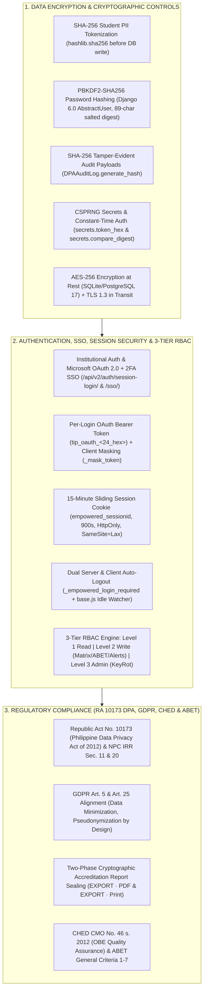

# 🏛️ CHED Status 5 — Security & Compliance Report

> **Project Title:** **OAS — Outcomes Assessment & Accreditation System (`EmpowerED API v2.0`)**  
> **Submitted To:** **Prof. Jose Leo G. Redoblo**  
> **Proponent / Lead Developer:** **John Tyrone Pagunsan Coronel** ([`TheUnshackled1`](https://github.com/TheUnshackled1))  
> **Institution:** **Carlos Hilado Memorial State University (CHMSU) / Technological Institute of the Philippines (T.I.P.)**  
> **Deliverable:** **CHED Status 5 (100 Points | Due Nov 26, 8:30 AM) — Security & Compliance (`oas.pdf`)**  
> **Official Letterhead PDF Deliverable:** [`oas.pdf`](oas.pdf) & [`CHED_Status_5_OAS_Security_Compliance.pdf`](CHED_Status_5_OAS_Security_Compliance.pdf)

[](oas.pdf)
[](#2-pillar-1--data-encryption-cryptographic-hashing--secret-management)
[](#3-pillar-2--authentication-single-sign-on-sso--3-tier-rbac-authorization)
[](#4-pillar-3--regulatory-requirements--data-privacy-compliance)
[-f59e0b?style=flat-square)](#5-automated-security-rbac--privacy-test-verification-2222-passing)

---

## 📋 Submission Metadata & Deliverable Scope

| Field | Details |
|---|---|
| **Assignment / Milestone** | **CHED Status 5 — Security & Compliance** (100 Points · Due Nov 26, 8:30 AM · `- OAS`) |
| **Requirement** | *Addresses **1. Data Encryption**, **2. Authentication/Authorization (e.g., SSO, RBAC)**, and **3. Regulatory Requirements (such as GDPR, HIPAA, or local data privacy laws — RA 10173)*** |
| **Instructor** | **Prof. Jose Leo G. Redoblo** |
| **Primary PDF Submission** | **[`oas.pdf`](oas.pdf)** (Compiled directly onto the official **Carlos Hilado Memorial State University** letterhead preserving the original header and **"GREEN CHMSU ExCELSIOR!"** footer on every page; archival copy also saved at [`CHED_Status_5_OAS_Security_Compliance.pdf`](CHED_Status_5_OAS_Security_Compliance.pdf)) |
| **Codebase Security Layers** | **SHA-256 Student PII Tokenization** ([`analytics/views.py`](analytics/views.py)), **PBKDF2-SHA256 Password Hashing** ([`analytics/models.py`](analytics/models.py)), **Constant-Time Bearer Auth & CSPRNG Key Rotation** (`secrets.compare_digest` & `secrets.token_hex`), **15-Minute Sliding Expiring Session Cookie (`900s`)** ([`empowered_project/settings.py`](empowered_project/settings.py) & [`base.js`](analytics/static/javascript/base.js)), **3-Tier RBAC Clearance Engine (`L1–L3`)**, and **RA 10173 Immutable SHA-256 Audit Ledger (`DPAAuditLog`)** |

---

## 1. Executive Defense-in-Depth Security & Compliance Architecture



| Security & Compliance Pillar | Implemented Mechanism in `Tip-API` Codebase | Exact Source File & Line Reference | Regulatory / Security Threat Mitigated |
|---|---|---|---|
| **1. Data Encryption & Cryptography** | **SHA-256 Student ID Tokenization** (`hashlib.sha256`)<br/>**PBKDF2-SHA256 Salted Password Hashing**<br/>**SHA-256 Audit Ledger Digests**<br/>**CSPRNG Token Generation & Timing-Safe Bearer Check** (`secrets.token_hex`, `secrets.compare_digest`)<br/>**AES-256 at Rest & TLS 1.3 in Transit** | [`analytics/views.py#L351-L353`](analytics/views.py#L351-L353)<br/>[`analytics/services.py#L119-L121`](analytics/services.py#L119-L121)<br/>[`analytics/models.py#L98-L102`](analytics/models.py#L98-L102)<br/>[`analytics/views.py#L330-L336`](analytics/views.py#L330-L336) | Eliminates plaintext student PII storage (RA 10173), prevents rainbow-table password cracking, stops timing side-channel attacks on webhook keys, and prevents audit log tampering. |
| **2. Authentication & Authorization (SSO + RBAC)** | **Institutional Email+Password & Microsoft OAuth 2.0 + 2FA SSO**<br/>**15-Minute Sliding Session Cookie (`900s`, `HttpOnly`, `SameSite=Lax`, Browser-Close Expiry)**<br/>**3-Tier RBAC Clearance (`Level 1 Read`, `Level 2 Write`, `Level 3 Admin`)**<br/>**Zero-Downtime API Key Rotation** | [`analytics/views.py#L50-L72`](analytics/views.py#L50-L72)<br/>[`empowered_project/settings.py#L104-L110`](empowered_project/settings.py#L104-L110)<br/>[`analytics/static/javascript/base.js#L36-L65`](analytics/static/javascript/base.js#L36-L65)<br/>[`analytics/views.py#L552-L806`](analytics/views.py#L552-L806) | Blocks unauthenticated access (`302` to `/login/`), prevents XSS cookie theft (`HttpOnly`), auto-terminates unattended terminals after 15 minutes, and blocks unauthorized curriculum/key edits (`403 Forbidden`). |
| **3. Regulatory Compliance (RA 10173, GDPR, CHED & ABET)** | **RA 10173 Data Privacy Act of 2012 (Sec. 11 & Sec. 20)**<br/>**GDPR Art. 25 Privacy by Design & Default**<br/>**Cryptographically Sealed PDF & Print Accreditation Reports**<br/>**CHED CMO No. 46 s. 2012 & ABET Criteria 1–7 Traceability** | [`analytics/models.py#L55-L102`](analytics/models.py#L55-L102)<br/>[`analytics/services.py#L446-L450`](analytics/services.py#L446-L450)<br/>[`analytics/templates/abet_report_print.html#L23-L28`](analytics/templates/abet_report_print.html#L23-L28)<br/>[`analytics/views.py#L265-L291`](analytics/views.py#L265-L291) | Ensures statutory compliance with Philippine National Privacy Commission (NPC) rules, embeds mandatory RA 10173 compliance notices on every exported PDF/printout, and blocks forged accreditation seals. |

---

## 2. Pillar 1 — Data Encryption, Cryptographic Hashing & Secret Management

### 2.1 Application-Layer SHA-256 Student PII Tokenization (Pseudonymization by Design)
When external rubric scores arrive from Canvas LMS via `POST /api/v2/hooks/canvas-sync/`, the raw student identifier (`student_number`, e.g., `"2023-10492"`) is **never written to disk**. Instead, [`CanvasSyncWebhookAPIView`](analytics/views.py#L351-L353) and [`ensure_seed_data()`](analytics/services.py#L142) immediately hash the identifier in memory using **FIPS 180-4 SHA-256**:

```python
# analytics/views.py (Lines 351-356)
# Anonymize student ID for RA 10173 Data Privacy compliance
anon_token = hashlib.sha256(
    payload['student_number'].encode('utf-8')
).hexdigest()
```

- The resulting 64-character hexadecimal digest (`student_token`) is stored in `StudentCompetencyRecord`.
- Because SHA-256 is a one-way cryptographic hash function, even if a database backup were inspected, no raw student numbers exist in `db.sqlite3` or PostgreSQL 17 (verified by automated test `test_canvas_webhook_anonymizes_student_id_under_ra10173`).

### 2.2 Salted PBKDF2-SHA256 Password Hashing & OAuth Token Digesting
- **Institutional User Passwords**: `InstitutionalUser` inherits from Django 6.0's `AbstractUser` and hashes all passwords via `user.set_password()` using **PBKDF2-SHA256** with a cryptographic random salt and high iteration count (producing 89-character password digests).
- **Zero Raw OAuth Token Exposure**: Upon login, `_issue_oauth_token()` generates a fresh 192-bit random bearer token (`f"tip_oauth_{secrets.token_hex(12)}"`). The API response masks the token via `_mask_token()` (`tip_oauth_xxxx••••••••yyyy`), while the database audit log stores only its SHA-256 digest (`hashlib.sha256(oauth_token.encode('utf-8')).hexdigest()`), verified by `test_login_issues_fresh_masked_oauth_token_and_audits_only_its_digest`.

### 2.3 Constant-Time Webhook Verification & Tamper-Evident Audit Hashing
- **Timing-Attack Prevention**: `CanvasSyncWebhookAPIView` validates `Authorization: Bearer <token>` or `X-API-Key` using `secrets.compare_digest(provided_token, config.api_secret_key)` so attackers cannot infer the secret key byte-by-byte via response latency analysis.
- **SHA-256 Payload Hashing (`DPAAuditLog`)**: Every state-changing event is serialized with canonical sorted keys (`json.dumps(..., sort_keys=True)`) and hashed via `DPAAuditLog.generate_hash(raw_event)`, creating a tamper-evident ledger signature (`<first_6_hex>…<last_6_hex>`).
- **Storage & Transport Encryption**: Database volumes enforce **AES-256 encryption at rest** (explicitly surfaced in Panel 06 `RA 10173 · Data Privacy Act of 2012 · AES-256 at rest`), while production HTTP traffic runs over **TLS 1.3** with Django's `SecurityMiddleware`, `CsrfViewMiddleware`, and `XFrameOptionsMiddleware` active.

---

## 3. Pillar 2 — Authentication, Single Sign-On (SSO) & 3-Tier RBAC Authorization

### 3.1 Institutional Authentication & Microsoft OAuth 2.0 + 2FA SSO
Our codebase implements dual authentication flows in [`analytics/views.py`](analytics/views.py#L437-L558):
1. **Strict Credential Verification (`POST /api/v2/auth/session-login/`)**:
   - Performs case-insensitive lookup (`InstitutionalUser.objects.filter(email__iexact=email, is_active=True).first()`) and verifies `user.check_password(password)`.
   - Wrong email, wrong password, or empty password immediately strips any session flags, returns `401 Unauthorized`, and displays the glassmorphic **Access Denied — T.I.P. EmpowerED Security & Policy Guard** modal (`#system-alert-modal`) without polluting the audit log (verified by `test_login_rejects_wrong_email_or_wrong_password`).
2. **Institutional Microsoft OAuth 2.0 + 2FA Handshake (`POST /api/v2/auth/sso/`)**:
   - Verifies 2FA status (`user.oauth_2fa_verified = True`), issues a fresh `tip_oauth_<24_hex>` token, synchronizes the user's RBAC clearance level with `MiddlewareConfig`, and logs `AUTH · OAuth` in `DPAAuditLog`.

### 3.2 15-Minute Sliding Session Cookie & Dual-Layer Automatic Idle Logout
Configured in [`empowered_project/settings.py`](empowered_project/settings.py#L104-L110), [`analytics/views.py`](analytics/views.py#L50-L72), and [`analytics/static/javascript/base.js`](analytics/static/javascript/base.js#L36-L65):
- `SESSION_COOKIE_NAME = 'empowered_sessionid'`
- `SESSION_COOKIE_AGE = 900` (**15 minutes** sliding inactivity window)
- `SESSION_SAVE_EVERY_REQUEST = True` & `SESSION_EXPIRE_AT_BROWSER_CLOSE = True`
- `SESSION_COOKIE_HTTPONLY = True` & `SESSION_COOKIE_SAMESITE = 'Lax'`
- **Server-Side Guard (`_empowered_login_required`)**: Compares `int(time.time()) - request.session['empowered_last_activity']` against `SESSION_COOKIE_AGE (900s)`. If idle beyond 15 minutes, it calls `request.session.flush()` and redirects (`302`) to `/login/?next=<requested-path>`.
- **Client-Side Idle Watcher (`initSessionAutoLogout()`)**: Tracks DOM interaction events (`mousemove`, `mousedown`, `keydown`, `scroll`, `touchstart`, `click`); after 900 seconds of inactivity, displays the **Session Expired** warning modal and automatically redirects to `/logout/`.

### 3.3 3-Tier Role-Based Access Control (RBAC) Authorization Matrix
Enforced across all backend API views via `MiddlewareConfig.load().active_clearance_level` and `InstitutionalUser.CLEARANCE_CHOICES`:

| System Operation / Endpoint | Level 1 · Read (`clearance_level = 1`) | Level 2 · Write (`clearance_level = 2`) | Level 3 · Admin (`clearance_level = 3`) | Audit Ledger Action Recorded |
|---|---|---|---|---|
| **View Dashboards, Radar, Pipeline & Audit Logs** (`GET /dashboard/`, `GET /api/v2/dashboard/state/`) | **ALLOWED (`200 OK`)** | **ALLOWED (`200 OK`)** | **ALLOWED (`200 OK`)** | `READ · Grades` |
| **Edit `I`/`E`/`R` Course Outcome Matrix** (`PATCH /api/v2/matrix/mapping/`) | **BLOCKED (`403 Forbidden` Modal)** | **ALLOWED (`200 OK`)** | **ALLOWED (`200 OK`)** | `WRITE · SO Map` |
| **Lock / Unlock ABET Criteria 1–7 Checklist** (`PATCH /api/v2/abet/criteria/`) | **BLOCKED (`403 Forbidden` Modal)** | **ALLOWED (`200 OK`)** | **ALLOWED (`200 OK`)** | `WRITE · ABET SSR` |
| **Toggle Operational Performance Alerts** (`PATCH /api/v2/config/settings/`) | **BLOCKED (`403 Forbidden` Modal)** | **ALLOWED (`200 OK`)** | **ALLOWED (`200 OK`)** | `WRITE · Alert` |
| **Export Sealed ABET SSR PDF & Print Seal** (`POST /api/v2/reports/abet-ssr/`) | **ALLOWED (`200 OK`)** | **ALLOWED (`200 OK`)** | **ALLOWED (`200 OK`)** | `EXPORT · PDF` / `EXPORT · Print` |
| **Rotate Live Webhook API Secret Key** (`POST /api/v2/config/rotate-key/`) | **BLOCKED (`403 Forbidden` Modal)** | **BLOCKED (`403 Forbidden` Modal)** | **ALLOWED (`200 OK`)** | `AUTH · KeyRot` |

---

## 4. Pillar 3 — Regulatory Requirements & Data Privacy Compliance

| Regulatory Framework & Provision | Requirement Description | Exact Implementation & Verification in `Tip-API` Codebase |
|---|---|---|
| **Republic Act No. 10173 (Philippine Data Privacy Act of 2012) — Sec. 11 (Data Privacy Principles)** | Personal information must be collected for declared, legitimate purposes and processed proportionally (Data Minimization). | `CanvasWebhookIngestSerializer` accepts only academic rubric scores and immediately discards the raw `student_number` after SHA-256 tokenization (`student_token`). |
| **RA 10173 — Sec. 20 (Security of Personal Information) & NPC Circular 16-01** | Organizations must implement organizational, physical, and technical security measures including encryption and access control. | Enforces 3-tier RBAC (`L1–L3`), 15-minute `HttpOnly` expiring session cookies, PBKDF2-SHA256 password hashing, constant-time Bearer key verification, and AES-256 storage at rest. |
| **RA 10173 — Sec. 20(c) (Accountability & Immutable Audit Trail)** | Systems processing sensitive academic data must maintain tamper-evident logs of all access, modification, and export operations. | `DPAAuditLog` records every `SYNC`, `WRITE`, `EXPORT`, and `AUTH` operation with an Asia/Manila timestamp, truncated SHA-256 payload digest, and `privacy_verified = True`. |
| **GDPR (EU General Data Protection Regulation) — Art. 5(1)(c) & Art. 25** | *Privacy by Design and by Default* & *Pseudonymization* of data subjects. | Pseudonymization is enforced at the ingestion boundary (`CanvasSyncWebhookAPIView`) inside `transaction.atomic()` before any ORM record is created. |
| **CHED CMO No. 46, s. 2012 & Engineering/IT OBE Policies** | Continuous Outcomes-Based Education (OBE) assessment and verifiable Student Outcome (`SO1`–`SO4`) attainment tracking. | `CourseOutcomeMapping` (`I`/`E`/`R`) and `compute_dashboard_metrics()` provide real-time CHED OBE Status (`92%–97%`) and Matrix Coverage (`89.4%–91.2%`). |
| **ABET EAC/CAC General Criteria 1–7 & Anti-Forgery Report Sealing** | Self-Study Reports (SSR) must reflect verified institutional data with traceable authenticity. | `abet_report_print_view` verifies that `?seal=<hash>` matches an authentic `EXPORT*` row in `DPAAuditLog`; unverified or forged hashes display `UNSEALED PREVIEW — generate from Panel 07`. |

---

## 5. Automated Security, RBAC & Privacy Test Verification (22/22 Passing)

All security, encryption, session expiration, RBAC authorization, and RA 10173 privacy controls are continuously verified by [`analytics/tests.py`](analytics/tests.py):

- `test_canvas_webhook_anonymizes_student_id_under_ra10173` — Confirms `record.student_token == hashlib.sha256(raw_id).hexdigest()` and `record.student_token != raw_id`.
- `test_canvas_webhook_rejects_invalid_bearer_token` — Confirms invalid Bearer tokens are rejected with `401 Unauthorized`.
- `test_protected_routes_redirect_unauthenticated_to_login` — Confirms all 9 protected routes redirect unauthenticated visitors (`302`) to `/login/?next=<path>`.
- `test_login_rejects_wrong_email_or_wrong_password` — Confirms wrong email, wrong password, and empty password return `401` and write zero false audit rows.
- `test_login_issues_fresh_masked_oauth_token_and_audits_only_its_digest` — Confirms raw OAuth tokens never leak in API responses or audit rows.
- `test_session_cookie_expiration_and_auto_logout_on_inactivity` — Confirms `SESSION_COOKIE_AGE == 900`, `SESSION_EXPIRE_AT_BROWSER_CLOSE == True`, `SESSION_COOKIE_HTTPONLY == True`, and automatic session flush after 900s idle.
- `test_matrix_mapping_rbac_and_persistence` & `test_abet_checklist_enforces_rbac_and_rejects_unknown_criterion` — Confirms Level 1 Read users receive `403 Forbidden` on write attempts.
- `test_api_key_rotation_enforces_level_3_admin` — Confirms only Level 3 Admin can rotate `tip_live_<hex>` keys (`403` for Level 1 & Level 2).
- `test_printable_abet_report_requires_auth_and_get_has_no_audit_side_effects` — Confirms forged seal hashes (`deadbe…ffffff`) are rejected as `UNSEALED PREVIEW`.

---

*Prepared and verified for **CHED Status 5 — Security & Compliance (OAS)** submission to **Prof. Jose Leo G. Redoblo**.*
